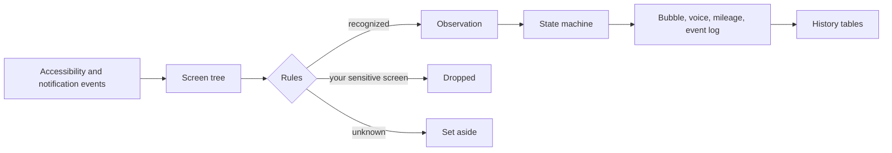

# gig.log

 

gig.log is an Android app for delivery drivers. It reads the delivery app's screens on your phone while you work and turns them into numbers about your own work. For each offer it shows the pay, the miles, the time and an estimate of your profit after vehicle costs. It tracks your miles during a shift and keeps a history of your shifts, deliveries and pay that you can look back on and export. The aim is to give you the same view of your own work that the platform already has.

gig.log is alpha software with one developer and one test phone. DoorDash is the app it is built and tested against. See [Status](#status).

## What it does today

**Offers.** When an offer appears, gig.log shows its pay, miles, minutes, profit after vehicle costs, pay per mile and pay per hour. It can read the offer aloud. It compares the offer with limits you set (minimum profit, maximum miles, maximum items) and names any limit the offer crosses. If the offer has no distance, gig.log says so and does not estimate a profit. An add-on offer is shown with the whole job's new totals when gig.log has the job's figures; otherwise it shows what the add-on adds.

**Accept and Decline from gig.log.** For DoorDash, the offer notification and the bubble's offer card have Accept and Decline buttons. When you press one, gig.log finds the matching button in the DoorDash app, checks that it is the right one, and taps it. gig.log does not accept or decline offers on its own.

**Two automatic taps, each with its own permission.** gig.log can confirm a decline for you when you turn on Quick declines, and it can open a collapsed pay breakdown on the delivery receipt. Each one stays off until you allow it. You can turn it off again under Settings > Data & privacy > Automation & consent.

**Shifts and miles.** gig.log notices when a shift starts, pauses and ends. It records your miles with GPS only while a shift is running, and it checks each GPS reading for accuracy, speed and jumps before it counts. You can end a shift by hand when gig.log missed the end, and correct a shift's miles when the tracked figure is wrong.

**The bubble.** An Android bubble shows your current shift over the delivery app: earnings so far, a daily goal, miles and time online, the current pickup or drop-off, and a log of the shift's jobs. From the bubble you can log a cash tip, an expense, a fill-up or an odometer reading, and set your daily goal.

**Vehicles and costs.** You keep a list of vehicles (gas car, hybrid, EV, motorcycle, scooter or moped, e-bike, bicycle). Each type starts with its own cost estimates, which you can change. gig.log uses the active vehicle's cost per mile to estimate profit.

**History.** The app has three tabs.

- Home shows today's profit, deliveries, miles and time online, the best stretch left today based on your past shifts, and this week so far.
- Analytics shows a past period in three views. Money shows where the pay came from. Offers lists each offer with its estimate, and compares the estimated pay per hour of accepted offers with what those deliveries made, as an average over the period. Time compares working time with waiting time and shows profit per hour.
- Playbook shows when and where you earn most, and a weekly plan built from your best hours. On Sunday evening gig.log grades the week against the plan.

A delivery from an evaluated offer keeps the cost figures that applied when it happened, so changing your costs later does not rewrite its profit. A delivery with no evaluated offer is priced with your current costs.

**Export.** Settings > Data & privacy > Export data saves your history as spreadsheet files to a folder you choose: deliveries, shifts, a summary with an estimated IRS mileage deduction, expenses and fill-ups. The files include store names. They leave out customer names and addresses. The same screen can save a bug report.

**Screenshots.** gig.log can save a screenshot of an offer, a delivery receipt or a shift summary to your gallery. This is off by default. A screenshot is the whole display, so it can show customer details and other apps, and a gallery that syncs can upload it.

## How it works

gig.log uses Android's accessibility service to read the view tree of the delivery app's windows, which is the text, labels and layout on your screen. A notification listener reads the delivery app's notifications. gig.log does not read the delivery app's network traffic or its code.

Recognition is data. Each platform has a set of rules that say what a screen looks like and which fields to read from it. The rules live in [`matchers/rules/`](matchers/rules/) as JSON5 and are compiled into the app at build time. A screen that no rule matches is set aside and does not change the app's state.



Recognized screens feed a state machine that tracks each platform's shift, offers and deliveries. Its output drives the bubble, the voice, the GPS mileage and an event log. The event log is the record of what happened. The history tables are built from it and can be rebuilt from it. All of this runs on the phone.

The full architecture is in [CLAUDE.md](CLAUDE.md) and, in more detail, in [`docs/architecture/`](docs/architecture/). Screen design rules are in [DESIGN.md](DESIGN.md).

## Privacy

[PRIVACY.md](PRIVACY.md) describes what the app reads, stores and sends, and names the file in the code that does each thing. It is the document to check. In short:

- Recognition, offer estimates and every money calculation run on the phone. There is no account, no analytics SDK and no advertising ID.
- The accessibility service listens only to the delivery apps. A separate permission, Screen events, lets it see which app is in front. You are asked for it first, and you can say no.
- Your own sensitive screens are dropped without being parsed or saved. That covers banking and DasherDirect balances and transfers, payment screens, your identity documents, the license-scan camera and the signature pad. Until the rules have loaded, every screen is dropped.
- Customer names and addresses are replaced with a one-way hash before they are saved to your history. Your history can tell two customers apart but does not keep who they are or where they live. Screenshots (off by default) and debug-build captures are the exceptions; [PRIVACY.md](PRIVACY.md) explains them.
- gig.log sends data off the phone only for features you turn on: the daily gas-price lookup (off by default on a new install) and the vehicle lookup in setup (it asks first). Spoken offers go to your phone's text-to-speech engine, which may use the network. Android backup and your own exports can also copy your history. PRIVACY.md lists each one with what is sent.
- These filters match known layouts on English screens. PRIVACY.md lists what they can miss.

[LEGAL.md](LEGAL.md) records the project's good-faith reading of the DoorDash Independent Contractor Agreement and the limits gig.log keeps to. It is a working draft and not legal advice.

## Status

gig.log is alpha. One developer builds it and tests it on one phone while delivering. Expect screens it does not recognize and changes between builds.

- DoorDash is the platform gig.log is built and field-tested against. Its rules cover offers, pickups, drop-offs, shift start and end, receipts and notifications.
- Uber has a smaller rule set: the offer card, online and offline screens, trip screens, shift summaries and trip notifications. It has had much less field testing. gig.log infers an accepted Uber offer when Uber's trip screen follows the offer, but this detection is incomplete ([#826](https://github.com/sjtrotter/gig.log/issues/826)). The Uber rules do not point gig.log at Uber's Accept and Decline buttons, so pressing Accept or Decline in gig.log does not tap them in Uber.
- Instacart Shopper and Walmart Spark are listed in the code but have no rules. The Play and sideload builds do not read them: their accessibility service is bound to DoorDash and Uber Driver only. The debug (tester) build reads them when the tester turns them on, so their screens, all unrecognized, can feed the census.
- Recognition expects the delivery app to be in English. In another language, screens go unrecognized. If the phone itself is set to a language other than English, gig.log shows a notice once.

### Supported apps

A table of what gig.log does with each delivery app, and in which build, is being decided in [#1417](https://github.com/sjtrotter/gig.log/issues/1417). It will go here once it is settled.

## Planned

None of these are built yet.

- A Google Play release, closed testing first ([#1412](https://github.com/sjtrotter/gig.log/issues/1412)), with APKs on the GitHub Releases page ([#1415](https://github.com/sjtrotter/gig.log/issues/1415)).
- A redesign of the history tabs as Home, Recap and Plan ([#1510](https://github.com/sjtrotter/gig.log/issues/1510), [#1511](https://github.com/sjtrotter/gig.log/issues/1511)).
- Uber: completing accepted-offer detection ([#826](https://github.com/sjtrotter/gig.log/issues/826)) and handling several offers shown at once ([#251](https://github.com/sjtrotter/gig.log/issues/251)).
- Accept and decline by voice ([#579](https://github.com/sjtrotter/gig.log/issues/579)).
- The rules in their own repository, sent to the app as signed updates, so drivers can choose where their rules come from ([#192](https://github.com/sjtrotter/gig.log/issues/192)).
- Opt-in, anonymized market figures built from many drivers' data ([#193](https://github.com/sjtrotter/gig.log/issues/193), [#1137](https://github.com/sjtrotter/gig.log/issues/1137)).
- Opt-in research with universities: empirical measurement of the visible offer surface, returning only anonymized aggregate results ([#194](https://github.com/sjtrotter/gig.log/issues/194)).

## Getting a build

No release has been published yet. A pull request's CI run (the PR Check workflow on the [Actions tab](https://github.com/sjtrotter/gig.log/actions)) uploads a debug APK as the artifact `debug-apk-<PR number>` once the build and tests pass. A run skipped with the skip-ci token, or one that fails before that step, uploads none. Downloading it needs a GitHub login, and GitHub keeps it for 7 days.

A debug build is a developer build. It differs from a release build in three ways:

- It saves screens it could not recognize to the app's files on the phone, for writing rules. These captures can contain customer details the filters missed, so do not post them publicly.
- It has an UNKNOWN-screen census uploader, off by default, in developer options. See [ADR-0011](docs/adr/ADR-0011-unknown-census-privacy-model.md) and PRIVACY.md §6.
- If you decline Screen events, the debug build turns its accessibility service off.

A release build saves no captures and cannot upload to the census.

## Building from source

You need Android Studio or the Android SDK, and JDK 21 (CI uses Temurin 21). Set `JAVA_HOME` to the JDK before you run Gradle. The project uses Kotlin 2.3, min SDK 30 and target SDK 36.

```bash
# Build the app
./gradlew :app:build

# Build the debug APK (app/build/outputs/apk/debug/app-debug.apk)
./gradlew :app:assembleDebug

# Run all unit tests
./gradlew testDebugUnitTest :domain:test censusContractTest

# Run only the recognition regressions (a fast check before a pull request)
./gradlew :app:testDebugUnitTest --tests "*AllMatchersSuite*"

# Run instrumented tests (needs a connected device or emulator)
./gradlew :app:connectedAndroidTest
```

CLAUDE.md lists the other build and test commands.

### Setting up the phone

1. Install the APK. The debug build installs as its own app, `cloud.trotter.log.gig.debug`.
2. Open gig.log. It walks you through six steps: Screen events, the accessibility service, notification access, location, notifications and bubbles.
3. Turn on the accessibility service under Android Settings > Accessibility > Downloaded apps > gig.log.
4. For the bubble, choose "All conversations can bubble" when Android asks.

## Working on the rules

Each platform's rules are JSON5 under [`matchers/rules/`](matchers/rules/). Uber is one file, [`uber.json5`](matchers/rules/uber.json5). DoorDash is a folder of files, one per part of the app, with a [README](matchers/rules/doordash/README.md). Each file names its schema with `$schema` ([`docs/rules.schema.json`](docs/rules.schema.json), or [`docs/rules.fragment.schema.json`](docs/rules.fragment.schema.json) for a DoorDash file), so an editor such as VS Code can check it as you type. The rule format is in [ADR-0001](docs/adr/ADR-0001-matcher-rule-format.md) and the source layout in [ADR-0009](docs/adr/ADR-0009-rule-distribution-channels.md).

Rules match the platform's own labels, view ids and layout, never a store's name. Rule regexes use RE2 syntax (no lookaround or backreferences) and run on a linear-time engine with size limits ([ADR-0010](docs/adr/ADR-0010-linear-time-rule-regex.md)).

The rules are tested against captured screens in `app/src/test/resources/snapshots/`. The "Snapshot regression testing" section of CLAUDE.md explains how to add screens and update the expected output.

## Reporting a problem

Open an [issue](https://github.com/sjtrotter/gig.log/issues/new). Say which delivery app, which screen and what went wrong. Leave out customer names, addresses and your own account details. The app's About screen lists a support address, support@trotter.cloud.

Changes that need checking on a real shift go on the [field-testing checklist](docs/field-testing/CHECKLIST.md), which says what to watch for and how to tell if it works.

## Acknowledgements

Parts of this project were written with AI coding tools: [Claude](https://claude.ai/) (through Claude Code), OpenAI Codex and [Google Gemini](https://gemini.google.com/).

## Licences

The app is licensed under the [PolyForm Shield License 1.0.0](LICENSE), copyright 2026 Stephen Trotter. The source is public, so you can check what the app does.

Two parts are licensed separately under Apache-2.0:

- the recognition rules in [`matchers/`](matchers/) ([licence](matchers/LICENSE)),
- the census wire contract in [`census-contract/`](census-contract/) ([licence](census-contract/LICENSE)), which the app shares with the census server, [dashbuddy-census](https://github.com/sjtrotter/dashbuddy-census) (AGPL-3.0).
